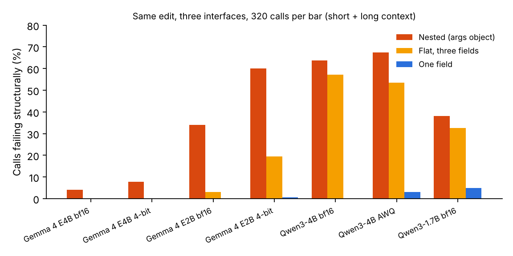
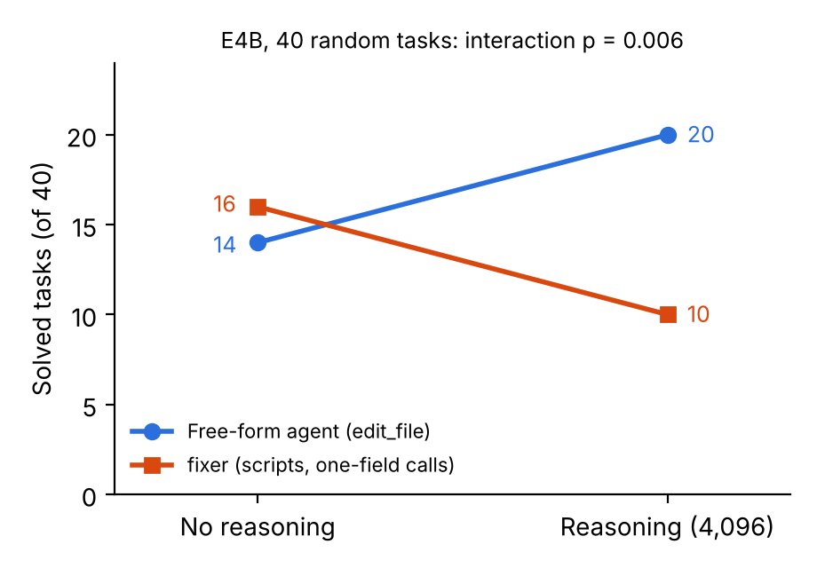

<div align="center">

# The Prompt Proposes, the Code Decides

**Interface Rules for Small Quantized Code Agents**

Roberto Vetere · Independent researcher

[Paper](docs/paper/paper_en.md) · [PDF](docs/paper/paper_en.pdf) · [Reproduce](docs/REPRODUCE.md) · [Notebook](notebooks/reproduce_paper.ipynb) · [Data](data/new_bench/) · [Results](results/)

</div>

---

How to connect small 4-bit models to tools as coding agents is largely unmeasured. This repository contains the agents,
data, infrastructure and per-call and per-task results behind a study of **Gemma 4 E4B and E2B, Qwen3-4B and Qwen3-1.7B,
with original and 4-bit weights**, repairing Python repositories scored by hidden tests, under hard limits of 8 minutes,
28 tool calls and 80 turns.

The design stance is simple: **the model proposes what to change; deterministic scripts locate code, apply edits and
run checks, and their verdict decides what happens next.**

## Results at a glance

| Question | Result | Where |
|---|---|---|
| Which tool-call interface survives in small models? | One long text per call (a single field or a file) stayed at **0–9%** structural failures in every model; calls with several fields failed in up to **73%** | 6,720 single calls, four models with original and 4-bit weights, one vLLM server (paper 4.2, Figure 1) |
| Is the interface the cause inside a real agent? | Same E4B, same scripts: **286 of 621** calls rejected with a three-field call, **0 of 687** with one-field commands; solved 8 vs 9 of 40 | Paper 4.3 |
| Does 4-bit quantization matter? | Not for E4B's isolated calls; it amplified E4B's call failures under long context, more so for E2B, and not for Qwen3-4B | Paper 4.2, 4.5 |
| Does reasoning help? | With a 31B it helped a free-form agent more than a script-guided one; the effect shrank on replication and vanished with 4-bit E4B | Three + two replicas on 40 tasks (paper 4.4, Figure 2) |
| Can single runs and local benches be trusted? | No: 0 of 8 trajectories repeated at temperature 0; an API silently served a 31B for E4B requests; local success did not transfer to the test set | Paper 4.6 |

Hypotheses for the generalization runs were committed before running them: [`docs/HYPOTHESES_12NOV.md`](docs/HYPOTHESES_12NOV.md)
(see its git history with `git log --follow docs/HYPOTHESES_12NOV.md`).

<p align="center">
  
  
</p>

## What is in this repository

| Path | Contents |
|---|---|
| [`docs/paper/`](docs/paper/) | The paper (Markdown and PDF) and its figures |
| [`docs/REPRODUCE.md`](docs/REPRODUCE.md) | Where every number in the paper comes from, and how to regenerate it |
| [`notebooks/reproduce_paper.ipynb`](notebooks/reproduce_paper.ipynb) | Regenerates every table from the saved results, on a CPU |
| [`docs/HYPOTHESES_12NOV.md`](docs/HYPOTHESES_12NOV.md) | Pre-registered hypotheses and their outcomes |
| [`docs/RUN_LOG.md`](docs/RUN_LOG.md) | Log of every evaluation run in the competition environment |
| [`variants/`](variants/) | Every agent compared in the paper, in the competition's submission format (`agent.yaml`, prompts, skills with scripts) |
| [`data/new_bench/`](data/new_bench/) | Validation set: 104 repair tasks from 24 repositories, each validated with the official oracle (65 also run locally), derived from a CC BY 4.0 dataset |
| [`lab/oneshot/`](lab/oneshot/) | Single-call experiments: the tool-call format test (`call_format.py`) and localization/repair probes, with their summaries |
| [`local/shim_vllm.py`](local/shim_vllm.py) | A bridge that poses as the vLLM server to the official evaluator and forwards to an OpenAI-compatible API or to our vLLM server, with a spending cap |
| [`local/run_local.py`](local/run_local.py) | Runs the official evaluator locally, with a subprocess sandbox or a Docker replica of the evaluation sandbox ([`local/docker/`](local/docker/)) |
| [`local/modal_vllm.py`](local/modal_vllm.py) | Serves the exact weights (vLLM 0.19.1, each family's parsers) on [Modal](https://modal.com), scaling to zero when idle |
| [`local/modal_eval.py`](local/modal_eval.py) | Runs a full evaluation on four L4 GPUs on Modal, matching the competition environment |
| [`results/`](results/) | Per-call and per-task results of every run cited in the paper |
| [`scripts/`](scripts/) | Submission builder and validator, and the evaluation kernel |
| [`.github/workflows/`](.github/workflows/) | The GitHub Actions workflows used to launch runs on Kaggle and Modal (they need the author's secrets) |

## Reproduce

Check every table from the saved results, at no cost (no GPU, no API key):

```bash
python3 lab/oneshot/summary_format.py results/call_format/*.jsonl      # 4.2: four models, three interfaces
python3 local/count_ab.py results/modal_e4b_4bit/ab_calls.jsonl results/modal_e4b_4bit/ab   # 4.3: interface A/B
python3 local/replica_table.py results/modal_e4b_4bit/q1 results/modal_e4b_4bit/q2      # 4.4: E4B 4-bit 2x2
python3 lab/oneshot/summary_quantization.py                                # 4.5: single calls, bf16 vs 4-bit
```

[`docs/REPRODUCE.md`](docs/REPRODUCE.md) maps every number to its file and command, and explains how to re-run the
agents (official evaluator wheels and an OpenAI-compatible endpoint serving the model).

## Citation

```bibtex
@misc{vetere2026promptproposes,
  author       = {Roberto Vetere},
  title        = {The Prompt Proposes, the Code Decides: Interface Rules for Small Quantized Code Agents},
  year         = {2026},
  howpublished = {\url{https://github.com/RobertoVetere/nervo-gemma-paper}},
  note         = {Paper Track, Google -- The Gemma 4 Developer Agent Competition}
}
```

## Acknowledgements

The evaluation harness, tasks and quantized Gemma models are from the
[Gemma 4 Developer Agent Competition](https://www.kaggle.com/competitions/gemma-4-developer-agent) (Markowitz et al., 2026).
The free-form baseline is the public community single agent published as a Kaggle sample notebook
(`gemma-4-harness-fixed-single-agent`). The task bank derives from D. Gluzdov's
*gemma-4-task-soundness-and-local-results* dataset (CC BY 4.0).

## License

Code: [Apache 2.0](LICENSE). The task data in `data/new_bench/` keeps its original CC BY 4.0 license.
