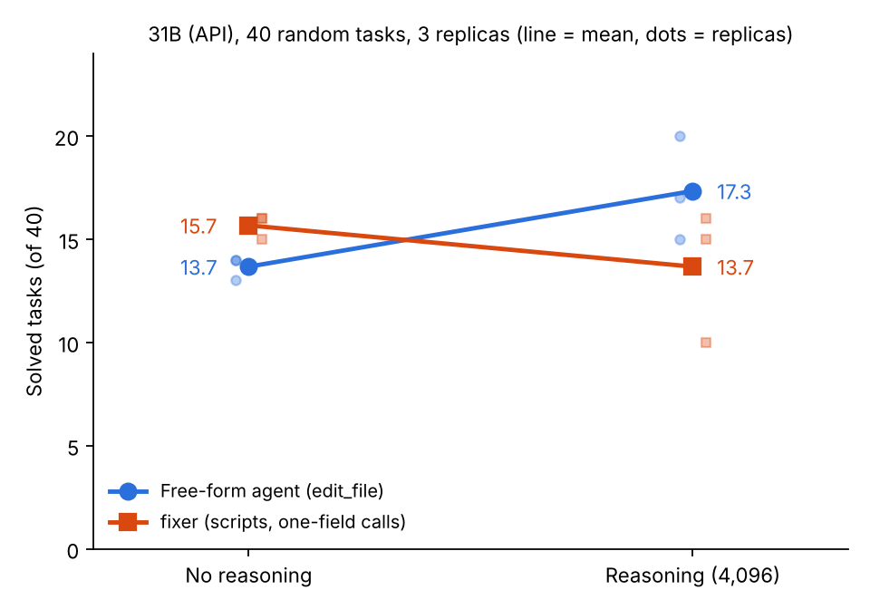

# The Prompt Proposes, the Code Decides: Interface Rules for Small Quantized Code Agents

**Roberto Vetere** · Independent researcher · [github.com/RobertoVetere](https://github.com/RobertoVetere)

## Abstract

How to connect small 4-bit models to tools as coding agents is largely unmeasured. We study Gemma 4 E4B (official 4-bit weights) and 31B repairing Python repositories scored by hidden tests, under one principle: the model proposes the change; deterministic scripts locate code, apply edits and decide the next step. First, with one-field calls and long text passed through files, none of 105 agent calls was rejected, against 81–88% with a three-field call. A controlled test of 1,920 calls on one server shows why: long text nested in an argument object makes the model drop other fields, 4-bit weights amplify this only under long context (21 against 6 of 160), and flat calls almost never fail. Second, in isolated calls the 4-bit weights matched the original ones in repair, localization and reasoning length. Third, in a 2×2 experiment with three replicas, reasoning helped a free-form agent every time but not a script-guided one; a striking first-run interaction shrank on replication. Fourth, our evaluation hid three traps: tuning tasks, non-repeating runs, and an API that served a 31B model when asked for E4B. We condense the evidence into five design rules and release agents, data and a validation set.

## 1. Introduction

Coding agents are usually designed for large models behind commercial APIs. A small local model with quantized weights writes tool calls less reliably, edits less precisely, and spends its time budget on the tokens it generates.

We start from a simple principle: *the prompt proposes, the code decides*. The model chooses what to change; deterministic scripts find the code, apply the edit and run checks, and their verdict decides the next step. The principle comes from an earlier prompt-chaining tool in which validating each step raised a 0.5B model from 25% to 62.5% on 16 arithmetic problems (a single run).

## 2. Experimental setup

**Task.** Each task is a Python repository at a fixed commit, an issue text, and hidden tests that the fix must make pass or keep passing. The agent runs in a sandbox without network, with limits of 8 minutes, 28 tool calls and 80 model turns.

**Environment.** We use the evaluation environment of the Gemma 4 Developer Agent competition [1]: agents declared in YAML on Google's Agent Development Kit (ADK) [2], nine predefined tools, and custom code only as Python scripts in a *skill*, invoked with a three-field call. The framework summarizes the conversation every 15 events, after which the model no longer sees its instructions. We run the competition's evaluator with one documented sandbox patch for `src/` layouts.

**Models.** Gemma 4 E4B and Gemma 4 31B with 4-bit weights and 16-bit activations (w4a16) [3], served with vLLM 0.19.1 [4] on four NVIDIA L4 GPUs with the Gemma 4 parsers and a 32k context; for quantization comparisons the same server also runs the original bf16 E4B weights. Some experiments used a commercial API (DeepInfra); requests there for E4B were answered by `gemma-4-31B-it-turbo`, as we found after the fact (4.6), so we report those results as 31B (API). Temperature is 0.2 unless stated otherwise.

**Task sets.** The *validation set* has 104 tasks from 24 repositories of a public CC BY 4.0 collection [5] whose reference patch passes in the competition environment (65 also locally). The *development set* has the 72 locally runnable public competition tasks from three repositories. The *test set* has 58 held-out tasks, seen only as an aggregate score. Comparisons are paired.

## 3. Method

Our agent, `fixer`, has three tools (`run_command`, `write_file`, `submit_patch`) and one skill. Its only skill call copies the scripts into a git-ignored folder in the repository; after that, every step is a one-field shell command. The E4B version follows eight steps:

1. install the scripts;
2. write the issue text to a file;
3. `evidence.py` lists candidate functions from tracebacks, quoted commands and strings of the issue;
4. `show_function.py` shows a function and what it calls (at most two calls);
5. `callers.py` lists the places that call the function;
6. the model writes a small script of test cases, `check.py`;
7. the model writes a search-and-replace edit; `apply_edit.py` applies it or shows the closest real lines;
8. `verify.py` runs the cases and a related existing test, and returns `SUBMIT`, `FIX` or `NO_EDIT`.

Every script ends with a `NEXT:` line giving the exact next command, because the last tool output survives a summary. The 31B version skips steps 5 and 6 and checks the issue's own example.

## 4. Experiments and results

### 4.1 Tool calls fail in predictable ways

Across the traces of successive agent versions with the quantized models, five failures recur: two from framework conventions, three from how the model writes a call that vLLM extracts from free text.

| Failure | Cause | Remedy |
|---|---|---|
| The skill is called by the agent's name | The framework injects the agent's name into every request | Give agent and skill the same name |
| The skill does not load | Only lowercase names with hyphens are accepted | Validate names before running |
| The call is written as text and never runs | The model imitates the prompt's code-like notation | Describe calls as lists of fields |
| Fields are lost when an argument is long | Long text nested in an argument object (4.2) | Keep long text flat or in files |
| The same incomplete call is repeated 64 times | The summary removes the instructions | One-field commands and `NEXT` lines |

| Interface | Model | Task runs | Calls | Rejected for format | Edits not applied |
|---|---|---|---|---|---|
| Built-in tools (`edit_file`) | E4B | 56 | 810 | 12 (1.5%) | 57 |
| Built-in tools | 31B | 16 | 459 | 3 (0.7%) | 2 |
| Skill, three-field call | 31B | 20 | 930 | 819 (88%) | 0 |
| Skill, three-field call, three prompt versions | E4B | 3 | 43 | 12 (28%) | 1 |
| One-time install, one-field commands | E4B, 31B | 8 | 105 | 0 | 4 |

Of the 819 rejected three-field calls of the 31B, 653 were the naming failure; after names were fixed, 130 of 160 were still rejected (81%). With one-field commands, 0 of 105 were (95% upper bound: 3.5%), comparing successive versions over few runs. With built-in tools format failures are rare, but the small model loses edits by miscopying the text to replace.

### 4.2 A controlled test of the call format

Agent traces compare versions, not conditions, so we asked the model to apply one edit with one tool call, copying an old and a new block of real code (6–30 lines, 80 blocks from the validation repositories, two samples each) through three interfaces: the skill call with the text nested in an `args` object, a flat `edit_file(path, old_string, new_string)`, and a single `content` field holding a search-and-replace block. E4B ran on one vLLM server with the Gemma 4 tool parser, with the original bf16 or the official 4-bit weights, with or without 10,000 tokens of previously read code before the request.

| E4B, calls that lost fields, of 160 | bf16 | 4-bit | bf16 + context | 4-bit + context |
|---|---|---|---|---|
| Nested (`args` object) | 7 | 4 | 6 | **21** |
| Flat, three fields | 0 | 0 | 0 | 0 |
| One field | 0 | 0 | 0 | 1 |

As in agents, `skill_name` or `file_path` vanish or are absorbed into `args`. Nesting fails with either weights; flat calls do not, so the cause is nesting, not the number of fields. The 4-bit weights changed nothing on short requests but amplified the failure under long context (21 against 6; Fisher, p = 0.004, calls treated as independent). The 31B (API) lost fields in 0 and 6 of 160 calls. Blocks ending in a quote failed less.

### 4.3 Reasoning and agent structure, with replication

We crossed two agents with two reasoning settings on 40 random validation tasks: `fixer`, and a free-form public agent that edits files with the built-in tools. These runs went through the API and were therefore served by the 31B (4.6), not E4B. After a striking first run we repeated all four cells twice.

| 31B (API), 40 tasks, solved per replica (mean) | No reasoning | Reasoning (4,096 tokens) |
|---|---|---|
| Free-form agent | 14, 13, 14 (13.7) | 20, 17, 15 (**17.3**) |
| `fixer` | 16, 16, 15 (**15.7**) | 10, 16, 15 (13.7) |

Reasoning helped the free-form agent in all three replicas (+6, +4, +1), at 2.2 times the time per task of `fixer` without reasoning. Its harm to `fixer` did not replicate: −6 in the first run, 0 and 0 after. In that first run the per-task interaction favoured opposite effects in 11 tasks against 1 (sign test, p = 0.006); in the two new replicas alone it was 8 against 4 (p = 0.39). One part was stable: with reasoning, `fixer` hit the 80-turn limit in 5, 5 and 4 tasks, against 0, 0 and 1 without. The direction held, but the interaction fell from 12 tasks to 4 and 1: a single run overstated it.

### 4.4 What changes with quantization

Single calls located the code from a repository map and wrote an edit scored with the hidden tests, on 11 tasks where the agents of 4.3 disagreed, two samples each; both E4B weights ran on one server.

| Single call | E4B bf16 | E4B 4-bit | 31B (API) |
|---|---|---|---|
| Fix, no reasoning | 6 of 22 | 5 of 22 | 5 of 22 |
| Fix, with reasoning (up to 16,384 tokens) | 5 of 22 | 5 of 22 | 9 of 22 |
| Median tokens generated, with reasoning | 2,094 | 2,002 | 6,002 |
| Attempts lost because the search text did not match | 18 of 88 | 24 of 88 | 11 of 88 |
| Correct symbol located, 40 tasks: file list / map | 23 / 30 | 24 / 29 | 28 / 31 |

In isolated calls the 4-bit weights behaved like the original ones (miscopies 18 against 24, Fisher p = 0.38). Short reasoning and miscopies, first attributed to quantization, belong to the smaller model. Quantization's cost appeared only under long context (4.2), consistent with W4A16 being near-lossless on reasoning benchmarks [19].

### 4.5 Where the remaining failures are

**Localization is not the main problem.** A model-free retriever, `dossier.py`, combines the functions executed by the issue's example, BM25 [6] over function bodies and identifiers from the issue. The changed function or its class is among its top three candidates in 28 of 40 validation tasks and 38 of 72 development tasks (the function itself: 23 and 28). In the probes, when the quantized E4B had the right file, 55 of 64 repair attempts still failed.

**The edit format is not the main problem either.** We let the quantized model rewrite the whole function and replaced it by name in code. Copy failures vanished; solved attempts barely changed (6 against 5 of the 18 whose target was a function). What fails is the content of the change.

### 4.6 Evaluation pitfalls

**Tuning tasks inflate success.** The 31B agent solved 7 of the 8 tasks used to design it, but 14 of 40 random ones.

**Runs do not repeat.** With temperature 0, top-p 1 and a fixed seed, 0 of 8 trajectories were identical across two runs; they diverged at the third to fifth call, likely because batched inference is not batch-invariant [7].

**The API may serve another model.** Our requests for E4B were answered by a 31B: the provider had marked the model as replaced, our bridge logged the requested name, and the bill matched 31B prices to the cent. The response's `model` field showed it. The same agents solved a third to a half of validation tasks there, but scored 0.01 and 0.03 with 4-bit E4B on the competition test set: much of that gap is model size. Competition tasks are also shorter (median 72 words against 108) and never include a runnable example.

## 5. Related work and convergent evidence

SWE-bench [8] defined repository repair with hidden tests; SWE-agent [9] showed that the agent–computer interface matters, and Agentless [10] that a fixed localize–repair–validate pipeline can beat autonomous agents. We study the other end of the scale: an interface that a small quantized model cannot call incorrectly. Strict output formats degrade reasoning [17], and reasoning models overthink in agentic repair [18]; our replicated 2×2 agrees for the script-guided agent. 4-bit weights are near-lossless on reasoning benchmarks [19], yet in agents they amplify failures the model already has: 2.5 times more failed tool calls for Gemma 4 31B with an unchanged score [20], and more missed calls in a 1.7B model [21]. We see the same amplification only under long context (6 to 21 of 160 lost fields); in short isolated calls the QAT weights matched bf16. Other participants report agreeing results:

| Finding | This paper | Independent evidence |
|---|---|---|
| Interfaces steer; instructions do not | 0 of 105 one-field calls rejected | Prompt rules rarely followed; interface changes worked [11] |
| Long strings in structured calls break | Nested calls lose fields; 4-bit weights amplify it under long context (4.2) | Single-string edits cut failures from 56% to 2% [12]; we did not reproduce their quote trigger |
| Reasoning is not a free gain | Helps free-form agent (+3.7), not `fixer` (31B, 3 replicas) | Keeping or dropping earlier reasoning changed nothing [14]; thinking did not help in the time budget [15] |
| Localization is not the bottleneck | Model-free retriever: top 3 for 28 of 40 | Name lookup drives localization; graph edges change at most 3 of 75 [16] |
| Summaries remove instructions | Repeated calls; none with `NEXT` lines | Odds of solving halve after one compaction [13] |
| One run is one sample | 0 of 8 runs identical; a first-run effect shrank on replication | One leaderboard draw varies by about 1.5 tasks [13] |

## 6. Limitations

The 2×2 used a 31B through an API, not E4B; other comparisons use one run per condition; the format test treats repeated samples as independent calls; the probes do not fix localization; all results use one model family and framework.

## 7. Conclusion

For small quantized models, the interface decides whether an agent works, not how much it solves. The evidence suggests five rules:

1. **Keep long text flat.** Never nest it inside an argument object; a single field or a file is safest.
2. **Put the next step in the tool output**, the only text that survives a summary.
3. **Let code decide.** Scripts locate, apply and verify; the model's verdict is unreliable.
4. **Measure reasoning per design.** It helped one agent and not another with the same model.
5. **Validate with the deployed weights**, on random samples, with repeated runs, and check which model actually answered.

No rule fixed the content of the change, where most failures remain.

## Reproducibility

Code, agents, data and per-task results are at https://github.com/RobertoVetere/nervo-gemma-paper (tag `paper-v1`). `docs/REPRODUCE.md` lists the file and command behind every number; every table can be regenerated at no cost with `notebooks/reproduce_paper.ipynb`. The retriever and the 31B agents will be added after the competition closes (2 December 2026).

## References

[1] E. Markowitz, B. Perozzi, B. Rózemberczki et al. *Google – The Gemma 4 Developer Agent Competition.* Kaggle, 2026. https://www.kaggle.com/competitions/gemma-4-developer-agent

[2] Google. *Agent Development Kit (ADK).* https://google.github.io/adk-docs/

[3] Google. *Gemma 4 quantization-aware trained checkpoints (w4a16).* Hugging Face, 2026.

[4] W. Kwon et al. Efficient Memory Management for Large Language Model Serving with PagedAttention. SOSP 2023.

[5] D. Gluzdov. *gemma-4-task-soundness-and-local-results* (dataset, CC BY 4.0). Kaggle, 2026.

[6] S. Robertson and H. Zaragoza. The Probabilistic Relevance Framework: BM25 and Beyond. *Foundations and Trends in Information Retrieval*, 2009.

[7] H. He and Thinking Machines Lab. Defeating Nondeterminism in LLM Inference. *Thinking Machines Lab: Connectionism*, 2025.

[8] C. E. Jimenez et al. SWE-bench: Can Language Models Resolve Real-World GitHub Issues? ICLR 2024.

[9] J. Yang et al. SWE-agent: Agent-Computer Interfaces Enable Automated Software Engineering. NeurIPS 2024.

[10] C. S. Xia, Y. Deng, S. Dunn, L. Zhang. Agentless: Demystifying LLM-based Software Engineering Agents. FSE 2025. arXiv:2407.01489

[11] hassantavakoli. *Instructions lose to interfaces: what steers Gemma 4 31B as a coding agent.* Kaggle, 2026. https://www.kaggle.com/code/hassantavakoli/instructions-lose-to-interfaces-reproduce-tables

[12] M. M. Valiyavalappil et al. *Action-Masked LoRA and Empirical Failure Modes in Gemma 4 SWE Agents.* Kaggle, 2026. https://www.kaggle.com/code/mrmaheshv/action-masked-lora-swe-agents

[13] S. M. Hossain. *Why Your Leaderboard Can't See a 3-Point Gain.* Kaggle, 2026. https://www.kaggle.com/code/mobassir/why-your-leaderboard-can-t-see-a-3-point-gain

[14] hemantkumarbk. *Overflow is a symptom, not a cause* (ThoughtKeep). Kaggle, 2026. https://www.kaggle.com/code/hemantkumarbk/thoughtkeep-reproduction

[15] J. J. Harris. *Declarative Agents for Autonomous Software Engineering: A Gemma 4 Case Study.* Kaggle, 2026. https://www.kaggle.com/code/jefferyjeromeharris/gemma-4-dev-agent-paper

[16] lizhang20252026. *Nodes or Edges? What a Code Graph Actually Contributes to a Small Coding Agent.* Kaggle, 2026. https://www.kaggle.com/code/lizhang20252026/nodes-or-edges-tool-ablation-notebook

[17] Z. R. Tam et al. Let Me Speak Freely? A Study on the Impact of Format Restrictions on Performance of Large Language Models. EMNLP 2024 (Industry).

[18] A. Cuadron et al. The Danger of Overthinking: Examining the Reasoning-Action Dilemma in Agentic Tasks. arXiv:2502.08235, 2025.

[19] R. Liu et al. Quantization Hurts Reasoning? An Empirical Study on Quantized Reasoning Models. arXiv:2504.04823, 2025.

[20] J. Jang, K. Yang, H. Lim, H. Park. Flat Score, Amplified Failures: How the Error Budget Masks Damage in Quantized LLM Agents. arXiv:2607.27275, 2026.

[21] M. Roshaan, M. Aaliyan, S. Bin Zubair. Compression Breaks Discipline: Quantization Increases Missed Tool Calls in Small Language Models, but Not Mid-Size Ones. NeurIPS 2026 Workshop on SLMs for Agentic Systems.
