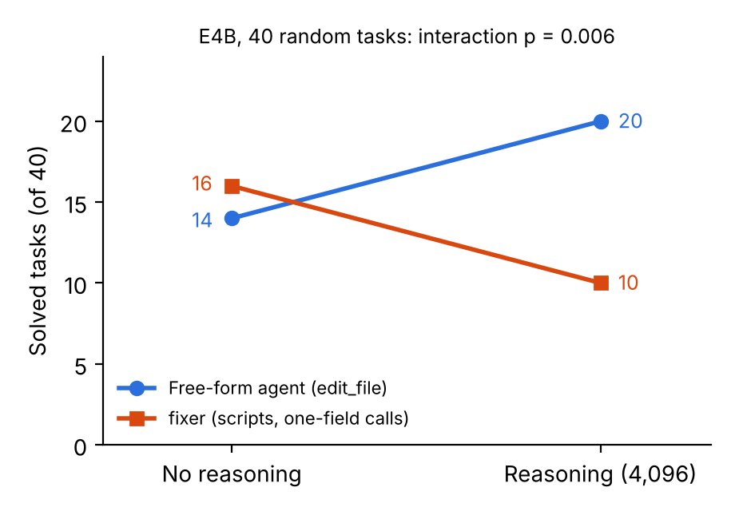

# El prompt propone, el código decide: diseño de interfaces para agentes de código pequeños y cuantizados

**Roberto Vetere** · Investigador independiente · [github.com/RobertoVetere](https://github.com/RobertoVetere)

## Resumen

Los modelos de lenguaje pequeños con pesos de 4 bits pueden mover agentes de código en hardware modesto, pero no está claro cómo conectarlos a las herramientas. Estudiamos Gemma 4 E4B y 31B (pesos de 4 bits) como agentes que reparan repositorios Python con límites fijos, puntuados con tests ocultos. El modelo propone el cambio; scripts deterministas localizan el código, aplican los cambios y ejecutan comprobaciones. Presentamos cuatro resultados de solidez distinta. Primero, las llamadas a herramientas fallan de cinco formas recurrentes; con una interfaz en la que cada llamada tiene un solo campo y los textos largos van por archivos, no se rechazó ninguna de 105 llamadas, frente al 81-88 % con la llamada de tres campos de versiones anteriores. Segundo, en un experimento exploratorio 2×2 sobre 40 tareas al azar, el razonamiento sumó seis tareas resueltas a un agente libre y restó seis a uno guiado por scripts (test de signo sobre la interacción, p = 0,006). Tercero, en pruebas exploratorias de una sola llamada, el modelo cuantizado generó un tercio de tokens al razonar y falló el doble de cambios por copiar mal el código. Cuarto, las tareas de ajuste inflan el acierto, las ejecuciones no se repiten ni con temperatura 0, y las tareas de desarrollo pueden diferir mucho de las tareas objetivo. Publicamos los agentes, un conjunto de validación de 104 tareas y herramientas para ejecutar el evaluador oficial fuera de la competición.

## 1. Introducción

Los agentes de código suelen diseñarse para modelos grandes detrás de APIs comerciales. Un modelo pequeño que corre en local con pesos cuantizados escribe las llamadas a herramientas con menos fiabilidad, edita con menos precisión y gasta su presupuesto de tiempo en los tokens que genera. Qué decisiones de diseño siguen valiendo en este escenario está, en gran parte, sin medir.

Partimos de un principio sencillo: *el prompt propone, el código decide*. El modelo elige qué cambiar. Scripts deterministas encuentran el código relevante, aplican el cambio y ejecutan comprobaciones, y su veredicto, no la valoración del propio modelo, decide el paso siguiente. El principio viene de una herramienta anterior de cadenas de prompts en la que validar cada paso subió a un modelo de 0,5B del 25 % al 62,5 % en 16 problemas de aritmética (una sola ejecución).

Lo ponemos a prueba en reparación de repositorios: dado un issue y una copia del repositorio, el agente debe producir un parche que pase tests ocultos. Nuestras medidas: una taxonomía de fallos de llamadas y una regla de interfaz que los eliminó (4.1); un experimento exploratorio sobre razonamiento y estructura del agente (4.2); pruebas de una sola llamada con pesos cuantizados y sin cuantizar (4.3); un recuperador sin modelo y un análisis de los fallos que quedan (4.4); y tres trampas de evaluación (4.5).

## 2. Montaje experimental

**Tarea.** Cada tarea es un repositorio Python en un commit fijo, el texto de un issue y tests ocultos que el arreglo debe hacer pasar o mantener pasando. El agente corre en un sandbox sin red, con límites de 8 minutos, 28 llamadas a herramientas y 80 turnos del modelo.

**Entorno.** Usamos el entorno de evaluación de la competición Gemma 4 Developer Agent [1]. Los agentes se declaran en YAML sobre el Agent Development Kit (ADK) de Google [2] y solo pueden usar nueve herramientas predefinidas: comando de terminal, leer, escribir y editar archivo, enviar el parche, consultar el estado y tres consultas sobre el grafo de código. El único código propio permitido es un conjunto de scripts Python empaquetados como *skill*, que el modelo invoca con una llamada de tres campos. El marco resume la conversación cada 15 eventos, y a partir de ahí el modelo ya no ve sus instrucciones. Ejecutamos el evaluador de la competición con un único cambio documentado: un parche del sandbox para que se puedan importar los repositorios con estructura `src/`.

**Modelos.** Gemma 4 E4B y Gemma 4 31B con pesos de 4 bits y activaciones de 16 bits (w4a16) [3], servidos con vLLM 0.19.1 [4] en cuatro GPU NVIDIA L4, con los parsers de llamadas y de razonamiento de Gemma 4 y 32k de contexto. Algunos experimentos usan los modelos sin cuantizar a través de una API comercial (DeepInfra). La temperatura es 0,2 salvo que se diga otra cosa.

**Conjuntos de tareas.** El *conjunto de validación* tiene 104 tareas de 24 repositorios, de una colección pública CC BY 4.0 [5], conservadas solo si el parche de referencia pasa los tests ocultos en el entorno de la competición (65 se ejecutan también en local). El *conjunto de desarrollo* tiene las 72 tareas de los datos públicos de la competición que se ejecutan en local, de tres repositorios. El *conjunto de test de la competición* tiene 58 tareas reservadas; solo vemos su puntuación agregada. Las comparaciones usan las mismas tareas y son emparejadas.

## 3. Método

Nuestro agente, `fixer`, tiene tres herramientas (`run_command`, `write_file`, `submit_patch`) y una skill. Su única llamada a la skill copia los scripts en una carpeta del repositorio que git ignora; a partir de ahí, cada paso es un comando de terminal de un solo campo. La versión para E4B sigue ocho pasos:

1. instalar los scripts;
2. escribir el texto del issue en un archivo;
3. `evidence.py` lista funciones candidatas: las que aparecen en trazas de error, el punto de entrada de cualquier comando citado en el issue y el código que contiene textos del issue;
4. `show_function.py` enseña una función y lo que llama (como mucho dos llamadas);
5. `callers.py` lista los sitios que llaman a la función;
6. el modelo escribe un pequeño script de casos de prueba, `check.py`;
7. el modelo escribe un cambio de búsqueda y sustitución, que `apply_edit.py` aplica, enseñando las líneas reales más cercanas cuando el texto buscado no coincide;
8. `verify.py` ejecuta los casos y un test existente relacionado, y devuelve `SUBMIT`, `FIX` o `NO_EDIT`.

Cada script termina con una línea `NEXT:` con la orden exacta siguiente, porque la última salida de herramienta siempre es visible para el modelo, incluso después de un resumen. La versión para el 31B es más corta: se salta los pasos 5 y 6, y `verify.py` ejecuta en su lugar el propio ejemplo del issue antes y después del cambio. En `joke2k__faker-2203`, el 31B arregló solo la primera línea que fallaba del ejemplo; `verify.py` informó de un nuevo `AttributeError` y el modelo completó el arreglo.

## 4. Experimentos y resultados

### 4.1 Las llamadas fallan de formas predecibles

Recogimos todas las llamadas rechazadas en las trazas de versiones sucesivas de nuestros agentes, ejecutadas con los modelos cuantizados en el entorno de la competición. Hay cinco fallos recurrentes. Los dos primeros vienen de convenciones del marco. Los otros tres vienen de cómo escribe el modelo una llamada cuando vLLM la extrae de texto libre; no aparecieron contra una API comercial que devuelve las llamadas estructuradas.

| Fallo | Causa | Remedio |
|---|---|---|
| Llama a la skill con el nombre del agente | El marco añade "tu nombre interno es X" a cada petición | Dar el mismo nombre al agente y a la skill |
| La skill no carga | Solo se aceptan nombres en minúsculas con guiones | Validar los nombres antes de ejecutar |
| Escribe la llamada como texto y nunca se ejecuta | El modelo imitó la notación tipo código del prompt | Describir cada llamada como una lista de campos |
| Se pierden campos cuando un argumento es largo | El modelo deja una cadena abierta y el parser mezcla los campos | Pasar los textos largos por archivos |
| Repite 64 veces la misma llamada incompleta | El resumen borra las instrucciones | Órdenes de un campo y líneas `NEXT` |

| Interfaz | Modelo | Ejecuciones de tarea | Llamadas | Rechazadas por formato | Cambios no aplicados |
|---|---|---|---|---|---|
| Herramientas integradas (`edit_file`) | E4B | 56 | 810 | 12 (1,5 %) | 57 |
| Herramientas integradas | 31B | 16 | 459 | 3 (0,7 %) | 2 |
| Skill, llamada de tres campos | 31B | 20 | 930 | 819 (88 %) | 0 |
| Skill, llamada de tres campos, tres versiones del prompt | E4B | 3 | 43 | 12 (28 %) | 1 |
| Instalación única, órdenes de un campo | E4B, 31B | 8 | 105 | 0 | 4 |

De las 819 llamadas rechazadas del 31B con la llamada de tres campos, 653 eran el fallo del nombre. Una vez arreglados los nombres, la llamada de tres campos se siguió rechazando en 130 de 160 llamadas (81 %). Con órdenes de un campo se rechazaron 0 de 105 (cota superior bilateral al 95 %: 3,5 %). Esto compara versiones sucesivas, no condiciones aleatorizadas, y la última fila cubre solo ocho ejecuciones de tarea. Con las herramientas integradas los fallos de formato son raros, pero el modelo pequeño pierde cambios porque no reproduce el texto a sustituir.

### 4.2 El razonamiento interactúa con la estructura del agente

Cruzamos dos agentes con dos configuraciones de razonamiento en 40 tareas de validación elegidas con semilla fija, con el E4B sin cuantizar y una ejecución por celda. El agente libre es un agente público de la comunidad de la competición, que edita los archivos directamente con las herramientas integradas. El agente guiado por scripts es `fixer`.

| E4B, 40 tareas | Sin razonamiento | Razonamiento (4.096 tokens) |
|---|---|---|
| Agente libre | 14 (67 s) | **20** (162 s) |
| `fixer` | **16** (63 s) | 10 (150 s) |

*Tareas resueltas y mediana de segundos por tarea. Los intervalos de Wilson al 95 % [6] van del 14-40 % (10 de 40) al 35-65 % (20 de 40).*

Las dos mejores celdas no son significativamente distintas: 5 tareas las resolvió solo el agente libre y 1 solo `fixer` (test exacto de McNemar [7], p = 0,22). `fixer` fue 2,5 veces más rápido. El razonamiento movió a los dos agentes en direcciones opuestas. Para cada tarea calculamos la ganancia del razonamiento en el agente libre menos la de `fixer`; 11 tareas apoyan esta interacción y 1 va en contra (test de signo, p = 0,006). Con razonamiento, `fixer` llegó al límite de 80 turnos en cinco tareas, y nunca sin él. Una lectura es que, cuando los scripts ya fijan los pasos, pensar más añade vueltas en lugar de mejores decisiones. Tratamos este resultado como exploratorio: hay una ejecución por celda, el test se eligió después de ver los datos y los dos agentes difieren en algo más que su estructura.

Cambiar el prompt no mejoró al agente libre. En 14 tareas en las que los agentes no coincidían, tres cambios (leer funciones enteras, ejecutar el ejemplo del issue, "entender antes de editar") resolvieron 8, 7 y 11, frente a 12 y 11 del original en dos ejecuciones; un cuarto, un mapa del repositorio, nunca llegó a usarse. Las 14 tareas se eligieron con los resultados del original, lo que le favorece.

### 4.3 Qué cambia con la cuantización

Para ver el modelo sin el agente hicimos llamadas sueltas: una para localizar el código a cambiar a partir de un mapa del repositorio, y otra para escribir un cambio sobre ese código, que aplicamos y puntuamos con los tests ocultos. Ejecutamos los mismos prompts con el E4B sin cuantizar (por API) y con el E4B cuantizado (nuestro propio servidor vLLM 0.19.1) en 11 de las 14 tareas en las que los agentes no coincidían, con dos muestras por tarea (razonamiento limitado a 16.384 tokens).

| Llamada suelta, E4B | Sin cuantizar | Cuantizado |
|---|---|---|
| Arreglo sin razonamiento | 5 de 22 | 5 de 22 |
| Arreglo con razonamiento | 9 de 22 | 5 de 22 |
| Mediana de tokens generados por respuesta, con razonamiento | 6.002 | 2.002 |
| Intentos perdidos porque el texto buscado no coincidía con el código | 11 de 88 | 24 de 88 |
| Símbolo correcto localizado, 40 tareas: lista de archivos / mapa del repositorio | 28 / 31 | 24 / 29 |

Cada modelo localiza el código por su cuenta, y la función localizada fue distinta en 6 de las 11 tareas, así que la comparación mezcla localización y arreglo; además, los dos modelos se sirvieron con sistemas distintos. Con esa salvedad, el modelo cuantizado generó un tercio de tokens al razonar, y falló el doble de cambios porque el texto copiado no coincidía con el código (test exacto de Fisher, p = 0,02). La diferencia en la ganancia del razonamiento (9 frente a 5 de 22) no es significativa (p = 0,33), y en las 10 muestras en las que ambos modelos localizaron el mismo código resolvieron lo mismo en todas las condiciones. No podemos atribuir a la cuantización la ganancia del razonamiento que falta.

Dos observaciones dentro del agente son coherentes con esto, como apoyo débil. Subir el presupuesto de razonamiento del agente cuantizado de 4.096 a 12.288 tokens no cambió nada en 6 tareas (1 resuelta en cada caso): escribía unos 200 tokens por llamada. Y en cuatro ejecuciones sobre otros conjuntos de tareas, el agente libre cuantizado usó una mediana de 6,5 a 18 llamadas por tarea, frente a 26 sin cuantizar en la muestra de 40.

### 4.4 Dónde están los fallos que quedan

**Localizar no es el problema principal.** Construimos un recuperador, `dossier.py`, que no usa ningún modelo. Reúne las funciones que ejecuta el ejemplo del issue, ordena los cuerpos de función con BM25 [8], busca identificadores del issue y añade el código de las candidatas, implementaciones parecidas del mismo archivo y los tests existentes que las usan, cada sección con una instrucción delante (antes de los tests: pasarlos no prueba un arreglo). Frente a los parches de referencia, la función cambiada o su clase está entre las tres primeras candidatas en 28 de 40 tareas de validación y 38 de 72 de desarrollo (la función exacta: 23 y 28). En las llamadas sueltas, cuando el E4B cuantizado tenía el archivo correcto, 55 de 64 intentos de arreglo siguieron fallando.

**Tampoco el formato del cambio.** Dejamos al modelo cuantizado reescribir la función entera y la sustituimos por su nombre desde el código. Los fallos de copia desaparecieron, pero los intentos resueltos casi no cambiaron (6 frente a 5 de los 18 cuyo objetivo era una función). Lo que falla es el contenido del cambio.

**El modelo grande.** Un agente con el 31B que lee el informe del recuperador resolvió 4 de 8 tareas de desarrollo en una ejecución a temperatura 0, y 1 de 4 y luego 3 de 3 tareas de validación en dos ejecuciones a 0,2. La varianza es alta y las ejecuciones demasiado pequeñas para compararlas con el modelo pequeño.

### 4.5 Trampas de evaluación

**Las tareas de ajuste inflan el acierto.** El agente del 31B resolvía 7 de las 8 tareas con las que se diseñó y 14 de 40 tareas al azar. Tres de las ocho están también entre las 40.

**Las ejecuciones no se repiten.** Con temperatura 0, top-p 1 y semilla fija, 0 de 8 trayectorias fueron idénticas entre dos ejecuciones sobre las mismas tareas; con entradas idénticas, las ejecuciones divergían entre la tercera y la quinta llamada. Una causa probable es que los kernels de inferencia por lotes no son invariantes a la composición del lote [9]; la configuración del agente no lo puede controlar. Una ejecución suelta hay que leerla como una muestra.

**Las tareas de desarrollo pueden diferir de las tareas objetivo.** Las tareas de la competición son descripciones de *pull requests*, no reportes de issues. Contando palabras de dos o más letras, su longitud mediana es de 72 palabras, frente a 108 en las 40 tareas de validación; 23 de 72 tienen menos de 30 palabras (2 de 40 en validación), y ninguna contiene un ejemplo que nuestro extractor pueda ejecutar (7 de 40 en validación). Las comprobaciones que ejecutan el ejemplo del issue, como el `verify.py` del 31B, nunca se activan en ellas. Con pesos sin cuantizar, el modelo pequeño resolvía el 40-50 % de las tareas de validación. Con los pesos cuantizados, los mismos agentes sacaron 0,01 y 0,03 en el conjunto de test de la competición, en torno a una o dos de 58 tareas. Una réplica Docker del sandbox reprodujo 4 de 5 resultados de validación, así que el entorno no explica la diferencia; descripciones más cortas, pesos cuantizados y repositorios distintos no se pueden separar con nuestros datos. Un conjunto de tareas local sirve para comparar versiones, no para predecir la nota objetivo.

## 5. Trabajo relacionado

SWE-bench [10] definió la reparación de repositorios puntuada con tests ocultos; SWE-agent [11] mostró que la interfaz entre el agente y el ordenador importa tanto como el modelo. Nosotros estudiamos el extremo opuesto de la escala: una interfaz que un modelo pequeño y cuantizado no pueda llamar mal. Otro participante informa de que el razonamiento reduce las llamadas mal formadas en modelos pequeños [12]; nosotros añadimos que su valor depende también de la estructura del agente.

## 6. Limitaciones

La mayoría de las comparaciones usan una ejecución por condición en 40 tareas o menos, así que solo se detectan efectos grandes, y las ejecuciones no se repiten exactamente. El experimento 2×2 usó pesos sin cuantizar y agentes que difieren en más de un aspecto; las llamadas sueltas cubren 11 tareas sin fijar la localización; los resultados de llamadas comparan versiones sucesivas. Todos los resultados vienen de una familia de modelos y un marco de agentes.

## 7. Conclusión

Con modelos pequeños y cuantizados, la interfaz decide si un agente funciona, no cuánto resuelve. Las llamadas de un campo con los textos largos en archivos hicieron fiable el uso de herramientas, y los scripts abarataron la localización y la comprobación; ninguna de las dos cosas arregló el contenido del cambio, que es donde están la mayoría de los fallos que quedan. Como el razonamiento interactúa con la estructura del agente y la cuantización cambia cómo razona y edita el modelo, los diseños de agentes deben validarse con los pesos desplegados, con muestras al azar, comparaciones emparejadas y ejecuciones repetidas.

## Reproducibilidad

El código, los agentes, los datos y los resultados por tarea están en https://github.com/RobertoVetere/nervo-gemma-paper (etiqueta `paper-v1`). `docs/REPRODUCE.md` indica el archivo y la orden detrás de cada cifra; la tabla 2×2 se regenera sin coste con `python3 local/tabla_lote.py resultados/local_deepinfra/l40`. El recuperador de la sección 4.4 y los agentes del 31B que lo usan se añadirán cuando cierre la competición, el 2 de diciembre de 2026.

## Referencias

[1] E. Markowitz, B. Perozzi, B. Rózemberczki et al. *Google – The Gemma 4 Developer Agent Competition.* Kaggle, 2026. https://www.kaggle.com/competitions/gemma-4-developer-agent

[2] Google. *Agent Development Kit (ADK).* https://google.github.io/adk-docs/

[3] Google. *Gemma 4 quantization-aware trained checkpoints (w4a16).* Hugging Face, 2026.

[4] W. Kwon et al. Efficient Memory Management for Large Language Model Serving with PagedAttention. SOSP 2023.

[5] D. Gluzdov. *gemma-4-task-soundness-and-local-results* (dataset, CC BY 4.0). Kaggle, 2026.

[6] E. B. Wilson. Probable Inference, the Law of Succession, and Statistical Inference. *Journal of the American Statistical Association*, 1927.

[7] Q. McNemar. Note on the Sampling Error of the Difference between Correlated Proportions or Percentages. *Psychometrika*, 1947.

[8] S. Robertson y H. Zaragoza. The Probabilistic Relevance Framework: BM25 and Beyond. *Foundations and Trends in Information Retrieval*, 2009.

[9] H. He y Thinking Machines Lab. Defeating Nondeterminism in LLM Inference. *Thinking Machines Lab: Connectionism*, 2025.

[10] C. E. Jimenez et al. SWE-bench: Can Language Models Resolve Real-World GitHub Issues? ICLR 2024.

[11] J. Yang et al. SWE-agent: Agent-Computer Interfaces Enable Automated Software Engineering. NeurIPS 2024.

[12] usp787. *Gemma4_paper_track.* GitHub, 2026. https://github.com/usp787/Gemma4_paper_track
